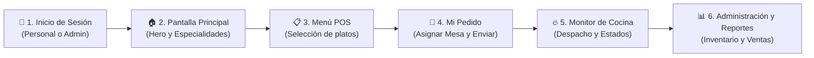

# 📖 Guía Integral y Manual de Funcionamiento: Derixk Food
> **Sistema Transaccional de Gestión Gastronómica y Punto de Venta (POS)**  
> **Autor & Desarrollador:** Dereck Rubira  
> **Institución:** Universidad Técnica de Machala (UTMACH) — 5to Nivel Ingeniería en Tecnologías de la Información  
> **Periodo Académico:** 2026-2  

---

## 🧭 1. ¿Cómo funciona Derixk Food en la vida real? (Lógica del Restaurante)

Derixk Food digitaliza y automatiza el ciclo operativo completo de un restaurante ecuatoriano moderno, garantizando consistencia de datos mediante transacciones ACID y reglas de negocio en base de datos.



### El Ciclo Operativo Paso a Paso:
1. **Inicio de Sesión (`/login`)**: El personal (Mesero, Cocinero o Administrador) se autentica con sus credenciales institucionales. El sistema genera un token seguro JWT con control de acceso basado en roles (RBAC).
2. **Inicio (`/home`)**: Vista de bienvenida con la identidad visual prémium, el carrusel con la fotografía panorámica del Gran Banquete Criollo y las especialidades de la casa.
3. **Menú POS (`/menu`)**: La carta digital dividida por categorías (Sopas y Caldos, Mariscos y Ceviches, Desayunos Típicos, Tradicionales). El mesero o cliente selecciona los platos deseados.
4. **Mi Pedido / Carrito (`/carrito`)**: Se revisa el resumen del pedido, se calcula el subtotal, IVA (15%) y total, se selecciona la mesa física (ej. Mesa #1) y se confirma la orden.
5. **Transacción en Base de Datos (PostgreSQL)**: Al confirmar el pedido, el backend ejecuta un bloque transaccional `BEGIN ... COMMIT`:
   - Registra el encabezado en la tabla `pedidos`.
   - Inserta cada línea en `detalles_pedido`.
   - Se activan triggers automáticos: `trg_descontar_stock` y `trg_auditar_precio`.
6. **Monitor de Cocina (`/pedidos`)**: Los cocineros ven las órdenes entrantes en tiempo real con su mesa y fecha/hora. Pueden avanzar el estado:
   - `pendiente` ➜ `en preparación` ➜ `listo` ➜ `entregado` ➜ `cancelado`.
7. **Reserva Inteligente de Mesas (`/reservas`)**: Los clientes o anfitriones reservan mesas. El trigger `trg_validar_reserva` en PostgreSQL rechaza reservas si la misma mesa ya está ocupada en un rango menor a 2 horas.
8. **Administración y Reportes (`/admin-platos` y `/reportes`)**: Exclusivo para el Administrador General para modificar precios, auditar cambios y visualizar KPIs de facturación mensual y platos más vendidos.

---

## 👥 2. Credenciales y Roles de Acceso

Para probar todos los flujos del sistema, utiliza cualquiera de las siguientes cuentas preconfiguradas con contraseñas encriptadas con `bcryptjs`:

| Rol | Correo Electrónico | Contraseña | Permisos y Alcance |
| :--- | :--- | :--- | :--- |
| **Administrador General** | `admin@restaurante.ec`<br>*(o `admin@restaurante.com`)* | `Admin123*` | **Control total**: Menú POS, Pedidos, Reservas, Creación/Edición de Platos, Auditoría y Reportes de Ventas. |
| **Mesero de Turno** | `mesero@restaurante.com`<br>*(o `jperez@restaurante.ec`)* | `Mesero123*` | **Toma de órdenes**: Menú POS, Mi Pedido/Carrito, Reservas de Mesas y consulta de comandas. |
| **Jefe de Cocina** | `cocina@restaurante.com`<br>*(o `cocina@restaurante.ec`)* | `Cocina123*` | **Despacho gastronómico**: Monitor de Cocina para cambiar estados de pedidos en tiempo real. |

---

## 🗂️ 3. Estructura y Orden Lógico de la Navegación

Para evitar confusiones y duplicidades (como tener "Comandas" y "Comanda" a la vez):

### Flujo para Visitante / No Autenticado:
1. **Iniciar Sesión (`/login`)** ➜ Entrada obligatoria para el personal operativo.
2. **Inicio (`/home`)** ➜ Presentación del restaurante y especialidades.
3. **Menú POS (`/menu`)** ➜ Explorar la carta y precios.
4. **Reservas (`/reservas`)** ➜ Agendar mesa.
5. **Acerca de (`/about`)** ➜ Ficha técnica y académica del proyecto.

### Flujo para Personal Autenticado:
1. **Inicio** (`/home`)
2. **Menú POS** (`/menu`)
3. **Monitor Cocina** (`/pedidos`) *(Antes llamado ambiguamente "Comandas")*
4. **Reservas** (`/reservas`)
5. **Admin Platos** (`/admin-platos`) *(Solo Admin)*
6. **Reportes** (`/reportes`) *(Solo Admin)*
7. **Acerca de** (`/about`)
8. **Botón Lateral:** **`Mi Pedido`** (`/carrito`) con contador de platos pendientes de enviar a cocina.
9. **Perfil:** Nombre y rol del usuario + Botón **Cerrar Sesión**.

---

## ⚙️ 4. Arquitectura Técnica (Evaluación Académica UTMACH)

### Frontend (Angular 22 SPA)
- **Standalone Components**: Modularidad sin `NgModule`.
- **Signals y Estado Reactivo**: Carrito de compras (`carritoService`) con reactividad instantánea mediante Signals (`cantidadTotal`, `subtotal`, `total`).
- **Guards de Seguridad**:
  - `authGuard`: Protege rutas contra usuarios sin sesión activa.
  - `roleGuard`: Restringe `/admin-platos` y `/reportes` únicamente a usuarios con rol `administrador`.
- **Interceptors HTTP**: Inyección automática de cabeceras `Authorization: Bearer <token>` en cada petición al backend.

### Backend (Node.js + Express)
- **Concurrencia con Pool**: Conexiones persistentes a PostgreSQL mediante librería `pg`.
- **Transacciones ACID**: Bloques `BEGIN ... COMMIT / ROLLBACK` en la creación de pedidos.
- **Autenticación Criptográfica**: JWT firmado con expiración de 8 horas y contraseñas hasheadas con salt rounds en `bcryptjs`.

### Base de Datos (PostgreSQL 16/18 - 3FN)
- **Normalización**: Modelo relacional en Tercera Forma Normal (3FN).
- **Triggers**:
  1. `trg_auditar_precio`: Guarda en `auditoria_precios` cualquier cambio de precio con usuario y fecha.
  2. `trg_descontar_stock`: Descuenta inventario al despachar platos.
  3. `trg_validar_reserva`: Previene solapamientos de 2 horas en la misma mesa.
- **Procedimientos Almacenados**:
  1. `sp_registrar_pedido`: Encapsula el cálculo de totales y registro.
  2. `sp_cerrar_pedido`: Cambia estado y libera la mesa.
- **Vistas SQL de Negocio**:
  1. `v_ventas_por_mes`: Agrupación mensual con sumatoria de ingresos.
  2. `v_platos_mas_vendidos`: Ranking de platos más solicitados.

---

## 🚀 5. Comandos de Arranque del Sistema

En terminales independientes:
```powershell
# Terminal 1: Backend
cd backend
npm run dev

# Terminal 2: Frontend
cd frontend
npm start
```
- **Frontend URL:** `http://localhost:4200`
- **Backend API URL:** `http://localhost:3000`
- **PostgreSQL Puerto:** `5432` (Base de datos: `restaurante_db`)
